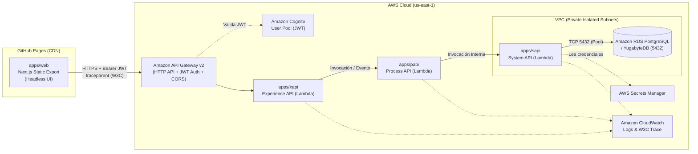

# PoC Arquitectura MACH & API-Led Connectivity en AWS

Prueba de Concepto (PoC) empresarial que implementa los principios **MACH** (**M**icroservices, **A**PI-first, **C**loud-native, **H**eadless) junto con el paradigma **API-Led Connectivity** (**xAPI**, **pAPI**, **sAPI**) sobre **Amazon Web Services (AWS)** utilizando un monorepo con **pnpm workspaces** y **Turborepo**.

---

## Tabla de Contenidos

1. [Arquitectura General](#arquitectura-general)
2. [Estructura del Monorepo](#estructura-del-monorepo)
3. [Base de Conocimiento LLM Wiki](#base-de-conocimiento-llm-wiki)
4. [Requisitos Previos y Toolchain](#requisitos-previos-y-toolchain)
5. [Autenticación en AWS (Sin Credenciales Estáticas)](#autenticación-en-aws-sin-credenciales-estáticas)
6. [Instalación y Comandos Rápidos](#instalación-y-comandos-rápidos)
7. [Documentación Técnica](#documentación-técnica)

---

## Arquitectura General



---

## Estructura del Monorepo

```text
aws-mach-architecture-poc/
├── .github/
│   ├── workflows/
│   │   ├── ci-pipeline.yml               # Lint, Type-check, Tests y validación CDK
│   │   ├── deploy-frontend-ghpages.yml   # Despliegue estático de Next.js a GitHub Pages
│   │   └── deploy-infra-cdk.yml          # Despliegue AWS CDK v2 mediante OIDC
│   └── dependabot.yml                    # Actualización agrupada de dependencias
├── .vscode/
│   ├── extensions.json                   # Extensiones recomendadas para VS Code
│   └── mcp.json                          # Servidores MCP de AWS Labs (Docs, IAM, CloudWatch)
├── apps/
│   ├── web/                              # Frontend Headless Next.js (Static HTML Export)
│   ├── xapi/                             # Experience API (Lambda + API Gateway v2)
│   ├── papi/                             # Process API (Lambda orquestador y reglas de negocio)
│   └── sapi/                             # System API (Lambda en VPC con acceso a PostgreSQL)
├── packages/
│   ├── database/                         # Esquema Drizzle/PG, migraciones y pool de conexiones
│   ├── types/                            # Contratos Zod, DTOs y utilidades W3C Trace Context
│   ├── tsconfig/                         # Configuraciones TypeScript base reutilizables
│   └── eslint-config/                    # Reglas de linting compartidas
├── infra/                                # Infraestructura como Código en AWS CDK v2
├── docs/                                 # Documentación técnica (C4, OpenAPI 3.1, Guía de Despliegue)
├── wiki/                                 # LLM Wiki (Base de conocimiento persistente estilo Karpathy)
├── AGENTS.md                             # Reglas estrictas para Agentes de IA y gobernanza del Wiki
├── pnpm-workspace.yaml
├── turbo.json
└── package.json
```

---

## Base de Conocimiento LLM Wiki

Este repositorio incluye una implementación del patrón **LLM Wiki** en el directorio [`wiki/`](wiki/index.md):
- [`wiki/index.md`](wiki/index.md): Catálogo centralizado de todas las páginas de conocimiento.
- [`wiki/log.md`](wiki/log.md): Registro cronológico (`append-only`) de ingestas, consultas, actualizaciones y auditorías.
- [`wiki/overview.md`](wiki/overview.md): Síntesis ejecutiva y estado actual del sistema.
- [`wiki/conventions.md`](wiki/conventions.md): Convenciones de formato, enlaces y mantenimiento.
- **Regla para Agentes**: Todo agente de IA debe cumplir las directivas de [`AGENTS.md`](AGENTS.md), consultando siempre el LLM Wiki antes de actuar y actualizándolo tras cada cambio.

---

## Requisitos Previos y Toolchain

- **Node.js**: `>= 20.x LTS`
- **pnpm**: `>= 9.x / 12.x` (`npm install -g pnpm`)
- **AWS CLI**: `v2.x`
- **AWS CDK**: `v2.x` (`npm install -g aws-cdk`)
- **uv**: Gestor ultrarrápido de Python para servidores MCP (`uvx`)

---

## Autenticación en AWS (Sin Credenciales Estáticas)

Por políticas de **DevSecOps**, no se utilizan claves estáticas (`AWS_ACCESS_KEY_ID`). Configura e inicia sesión mediante AWS IAM Identity Center (SSO):

```bash
aws configure sso --profile poc-mach-dev
aws sso login --profile poc-mach-dev
aws sts get-caller-identity --profile poc-mach-dev
```

---

## Instalación y Comandos Rápidos

```bash
# 1. Instalar dependencias en todo el monorepo
pnpm install

# 2. Compilar todos los paquetes y aplicaciones con Turborepo
pnpm build

# 3. Ejecutar validación de tipos TypeScript
pnpm type-check

# 4. Ejecutar pruebas unitarias
pnpm test

# 5. Sintetizar la plantilla CloudFormation de AWS CDK
pnpm --filter @poc-mach/infra synth
```

---

## Documentación Técnica

- [Arquitectura Detallada y Diagramas C4](docs/ARCHITECTURE.md)
- [Especificación Unificada OpenAPI 3.1](docs/OPENAPI.yaml)
- [Guía de Despliegue Local y Cloud](docs/DEPLOYMENT_GUIDE.md)
- [Índice del LLM Wiki](wiki/index.md)
- [Reglas de Agentes (AGENTS.md)](AGENTS.md)
