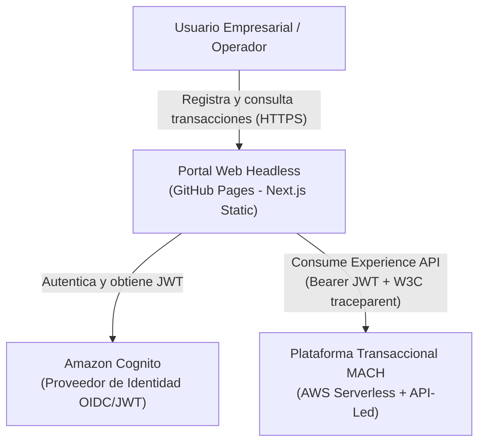
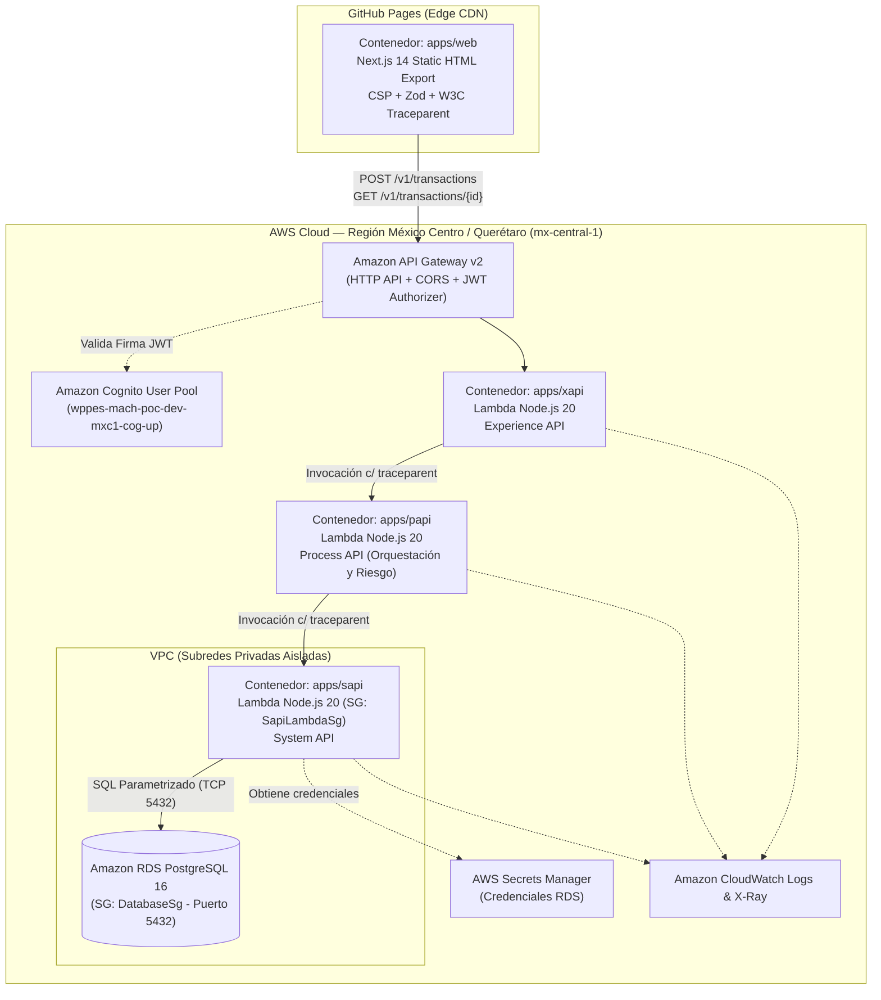

# Arquitectura Detallada: MACH & API-Led Connectivity en AWS

Este documento describe la arquitectura del sistema mediante el modelo **C4** (Contexto, Contenedores y Componentes), justificando la adopción combinada de **MACH** y **API-Led Connectivity**.

---

## 1. Diagrama C4 — Nivel 1: Contexto del Sistema

---

## 2. Diagrama C4 — Nivel 2: Contenedores y Red (AWS + GitHub Pages)

---

## 3. Justificación del Modelo API-Led Connectivity y MACH

| Pilar / Capa | Componente en Monorepo | Responsabilidad Principal | Aislamiento de Seguridad |
| :--- | :--- | :--- | :--- |
| **Headless UI** | `apps/web` | Interfaz desacoplada compilada a activos estáticos; aplica validación preventiva Zod y cabecera CSP. | Sin secretos de servidor; expuesta en CDN de GitHub Pages. |
| **Experience API (`xAPI`)** | `apps/xapi` | Adaptador de experiencia para el canal web; valida JWT Bearer, verifica esquemas y propaga `traceparent`. | Fuera de la VPC de datos; sin permisos sobre RDS ni Secrets Manager. |
| **Process API (`pAPI`)** | `apps/papi` | Lógica de dominio pura: evalúa umbrales de monto (`LOW`, `MEDIUM`, `HIGH`) y define el estado transaccional. | Sin exposición HTTP directa y sin conectividad a la base de datos. |
| **System API (`sAPI`)** | `apps/sapi` | Encapsula el acceso al *System of Record* (PostgreSQL / YugabyteDB) mediante `@poc-mach/database`. | En subred `PRIVATE_ISOLATED`; único Security Group autorizado hacia el puerto `5432` de RDS. |
